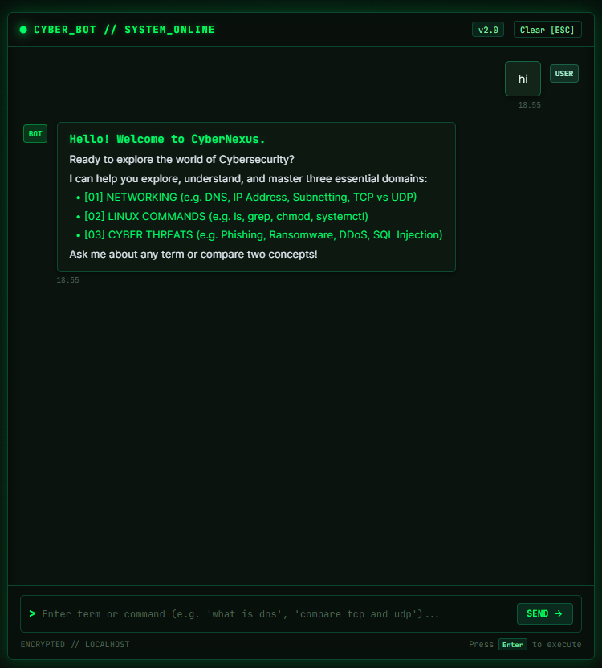
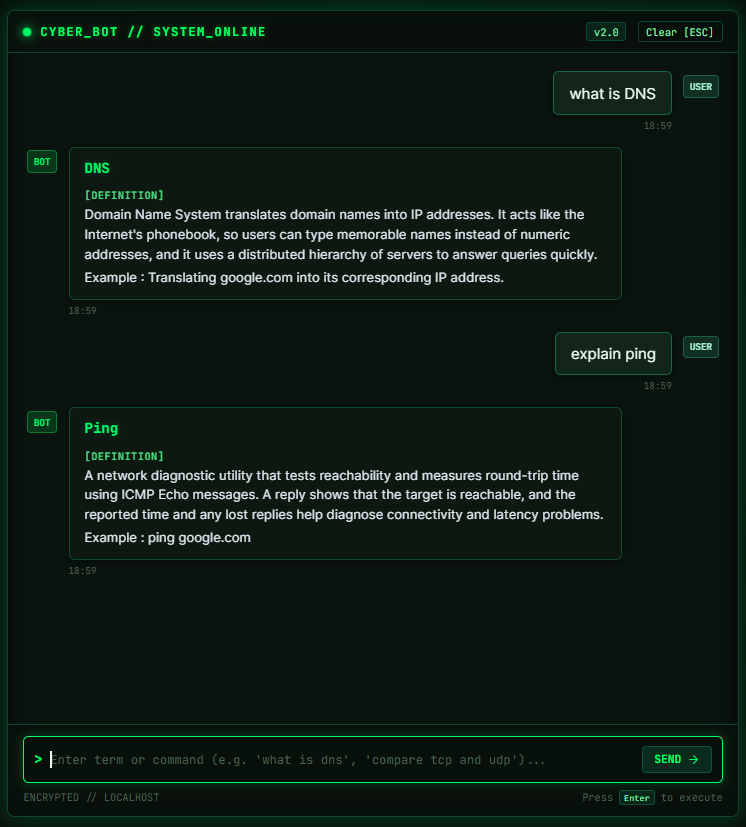
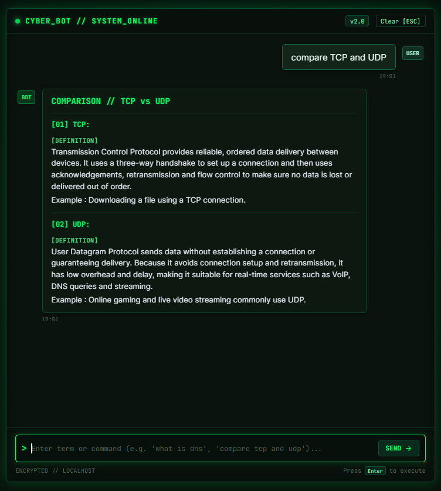
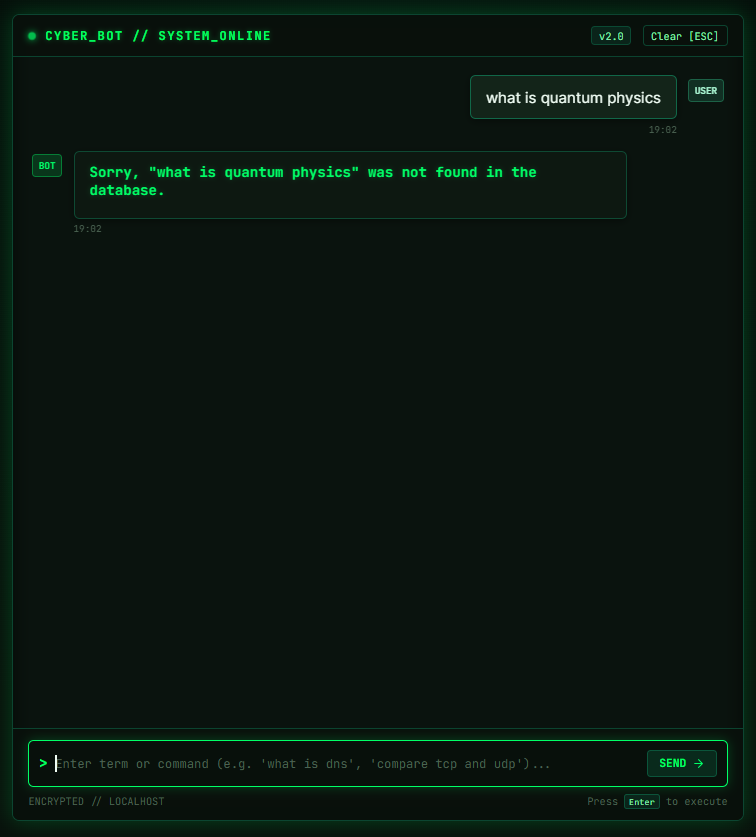

# CyberNexus - Cybersecurity AI Assistant

---

## Section A: Project Introduction

CyberNexus is an intelligent, offline cybersecurity assistance and search engine developed in C to help students and security enthusiasts explore core security concepts across Networking, Linux Commands, and Cyber Threats. The core objective of the system is to parse natural language queries, extract domain-specific terminology, and perform high-speed in-memory data retrieval from a structured JSON database using the cJSON library without recurring disk I/O. Implemented entirely in modular C with a pointer-based data pipeline, the program features dynamic in-memory dataset loading upon user greeting, case-insensitive keyword extraction, dual-term comparative analysis, structured response formatting, and memory leak prevention with comprehensive cleanup upon session termination.

---

## Section B: Features & Test Cases (Execution Scenarios)

* **Case 1: Session Greeting & In-Memory Dataset Loading**
  * **Description:** Tests the initial interactive handshake where the user enters a greeting, prompting the data reader to open `data/data.json`, parse its contents into memory via `cJSON_Parse()`, and display the ASCII welcome banner.
  * **Inputs:** `hi` (or `hello`, `hey`)
  * **Expected Output:** Confirmation of dataset loading into memory, ASCII banner display from `greetings.txt`, and readiness message prompting for user queries.
  * **Screenshot:**

  

* **Case 2: Single-Term Query & Structured Retrieval**
  * **Description:** Tests intent detection and keyword extraction for a single concept query, case-insensitive lookup across all dataset categories in memory, and structured terminal output formatting.
  * **Inputs:** `what is DNS` (or `explain ping`, `ls`, `what is phishing`)
  * **Expected Output:** Formatted record block presenting the matching Term name, its formal Definition, and a practical technical Example.
  * **Screenshot:**

  

* **Case 3: Multi-Term Comparative Search (Dual Entity Analysis)**
  * **Description:** Tests the system's ability to identify comparative syntax with two distinct entities, dispatching dual pointer-based queries through the search engine and rendering a side-by-side technical contrast.
  * **Inputs:** `compare TCP and UDP` (or `difference between hub and switch`, `ipv4 vs ipv6`)
  * **Expected Output:** Structured comparative response displaying `[01] TCP` and `[02] UDP` with their respective definitions and examples.
  * **Screenshot:**

  

* **Case 4: Invalid Input & Error Handling**
  * **Description:** Tests defensive error handling when a user submits queries containing unsupported terms, out-of-domain keywords, or unrecognized inputs, ensuring system stability without crashing.
  * **Inputs:** `what is quantum physics` (or random unsupported terms)
  * **Expected Output:** User-friendly notification stating the term was not found in the database, with guidance to re-enter a valid topic.
  * **Screenshot:**

  

* **Case 5: Session Termination & Memory Deallocation**
  * **Description:** Tests graceful session termination upon receiving exit commands, validating that all allocated memory in the cJSON hierarchy is completely freed using `cJSON_Delete()` to prevent memory leaks.
  * **Inputs:** `exit` (or `quit`, `bye`)
  * **Expected Output:** Polite termination message (`[CyberNexus]: Goodbye! Exiting session...`) followed by clean program termination.
  * **Screenshot:**

  

---

## 4. Instructions to Clone and Execute

Provide exact terminal/command line instructions inside your README.md so anyone can clone and run your code.

### Step 1: Clone the Repository
Open your terminal and execute:
```bash
git clone https://github.com/yasirazeemkhan2-spec/Project.git 
cd Project
```

### Step 2: Compile the Code
Compile your C code:
```bash
cd backend
gcc main.c cJSON/cJSON.c -o cybernexus.exe
```

### Step 3: Run the Program
Windows (Command Prompt):
```cmd
cybernexus.exe
```

*(Optional Web GUI: To launch the Dark-Green Hacker Web GUI, return to the project root directory and double-click `Run_GUI.bat` or open `frontend/index.html` in your browser).*
