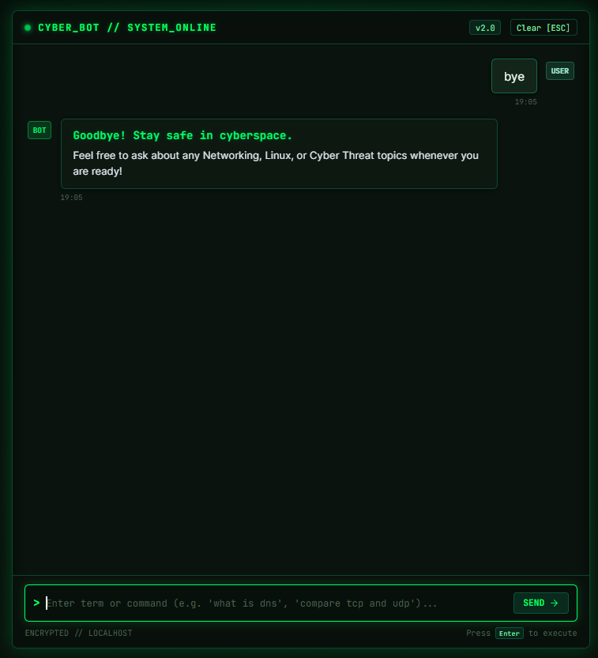
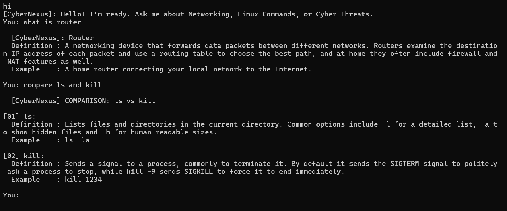
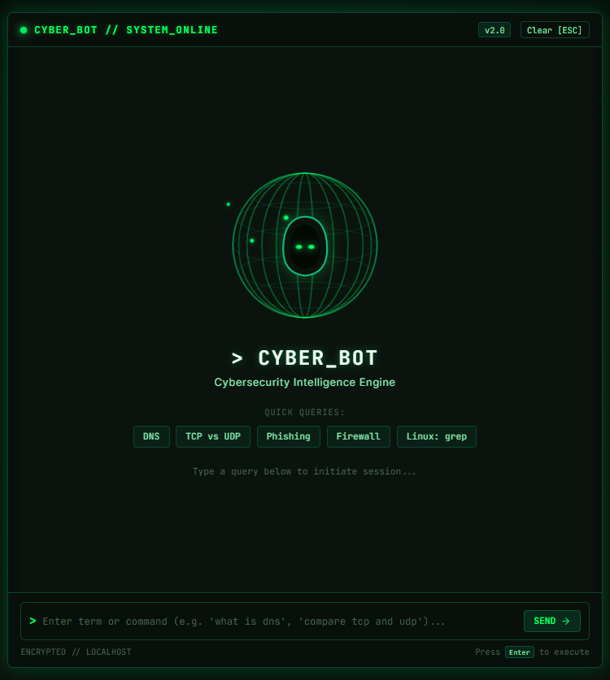
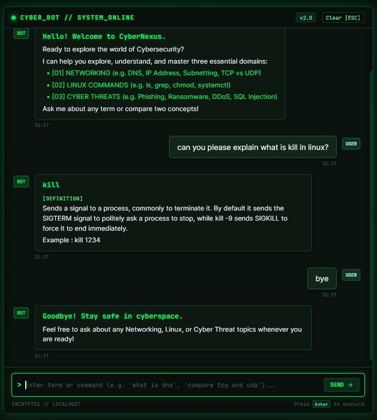

# CyberNexus — Cybersecurity Knowledge Chatbot

CyberNexus is a console-based chatbot written in **C** that answers questions about three areas of cybersecurity: **Networking**, **Linux Commands** and **Cyber Threats**. Its knowledge base is a JSON dataset of 600 terms (200 per category), each with a definition and a real-world example. A Node.js server and a browser-based terminal-style GUI are also included on top of the same C program.

**Course:** CL1002 Programming Fundamentals (Lab), FAST-NUCES Karachi

**Submitted by:** Yasir (26K-2048), Bilal (26K-2049)

**Submitted to:** Miss Hijaab Sikander


---

## Features

- Loads 600 cybersecurity terms from `data.json` at run time
- Detects the topic of a question from free-text input (keyword matching)
- Shows a **definition** and an **example** for the matched term
- **Comparison mode:** compares two terms in one question (e.g. `compare tcp and udp`)
- Greeting and exit handling, and a clear message for unknown terms
- Browser GUI with quick-query buttons, connected to the C program through Node.js

---
## Section B: Features & Test Cases (Execution Scenarios)
### Core System Features
- Loads 600 cybersecurity terms from `data.json` at run time (200 Networking, 200 Linux Commands, 200 Cyber Threats)
- Detects the topic of a question from free-text input via case-insensitive keyword extraction
- Shows a formal **Definition** and practical **Example** for every matched concept
- **Dual-Term Comparison Mode:** Compares two distinct concepts in a single query (e.g. `compare tcp and udp`)
- Robust input handling with friendly fallbacks for unknown terms and clean session termination
- Interactive Dark-Green Hacker Browser GUI with quick-query buttons, running seamlessly alongside the C backend
---
### Execution Test Cases
* **Case 1: Session Greeting & In-Memory Dataset Loading**
  * **Description:** Tests the initial interactive handshake where the user enters a greeting, prompting the data reader to open `data/data.json`, parse its contents into memory via `cJSON_Parse()`, and display the ASCII welcome banner.
  * **Inputs:** `hi` (or `hello`, `hey`)
  * **Expected Output:** Confirmation of dataset loading into memory, ASCII banner display from `greetings.txt`, and readiness message prompting for user queries.
  * **Screenshot:**
  
* **Case 2: Single-Term Query & Structured Retrieval**
  * **Description:** Tests intent detection and keyword extraction for a single concept query, case-insensitive lookup across all dataset categories in memory, and structured terminal output formatting.
  * **Inputs:** `what is DNS` (or `explain ping`, `ls`, `what is phishing`)
  * **Expected Output:** Formatted record block presenting the matching Term name, its formal Definition, and a practical technical Example.
  * **Screenshot:**
  
* **Case 3: Multi-Term Comparative Search (Dual Entity Analysis)**
  * **Description:** Tests the system's ability to identify comparative syntax with two distinct entities, dispatching dual pointer-based queries through the search engine and rendering a side-by-side technical contrast.
  * **Inputs:** `compare TCP and UDP` (or `difference between hub and switch`, `ipv4 vs ipv6`)
  * **Expected Output:** Structured comparative response displaying `[01] TCP` and `[02] UDP` with their respective definitions and examples.
  * **Screenshot:**
  
* **Case 4: Invalid Input & Error Handling**
  * **Description:** Tests defensive error handling when a user submits queries containing unsupported terms, out-of-domain keywords, or unrecognized inputs, ensuring system stability without crashing.
  * **Inputs:** `what is quantum physics` (or random unsupported terms)
  * **Expected Output:** User-friendly notification stating the term was not found in the database, with guidance to re-enter a valid topic.
  * **Screenshot:**
  
* **Case 5: Session Termination & Memory Deallocation**
  * **Description:** Tests graceful session termination upon receiving exit commands, validating that all allocated memory in the cJSON hierarchy is completely freed using `cJSON_Delete()` to prevent memory leaks.
  * **Inputs:** `exit` (or `quit`, `bye`)
  * **Expected Output:** Polite termination message (`[CyberNexus]: Goodbye! Exiting session...`) followed by clean program termination.
  * **Screenshot:**
  

---

## User Guide

### Getting Started

1. Run `cybernexus.exe` (console) or `Run_GUI.bat` (browser GUI).
2. Type a greeting (`hi`, `hello` or `hey`) to load the dataset. Nothing else works until you do this.
3. When `You:` appears, type your question and press **Enter**.
4. Type `exit`, `quit` or `bye` to leave.

### What You Can Ask

| Category | Example terms |
|---|---|
| **Networking** | DNS, DHCP, IP Address, MAC Address, Subnet Mask, Router, Switch, Firewall, NAT, TCP, UDP, HTTP/HTTPS, VPN, VLAN, OSI Model, Latency, Bandwidth |
| **Linux Commands** | `ls`, `cd`, `pwd`, `mkdir`, `grep`, `chmod`, `chown`, `sudo`, `ps`, `top`, `kill`, `df`, `curl`, `wget`, `systemctl` |
| **Cyber Threats** | Phishing, Ransomware, Spyware, Trojan Horse, Rootkit, Keylogger, Botnet, SQL Injection, XSS, CSRF, DDoS, Man-in-the-Middle Attack, ARP Spoofing, Brute Force Attack, Zero-Day Exploit, Social Engineering |

### How to Ask

- **Single term:** `what is dns`, `explain what is router`, `what does mkdir do`, `phishing`
- **Comparison:** `compare tcp and udp`, `tcp vs udp`

### Example Questions

| You type | What you get |
|---|---|
| `hi` | Greeting message, dataset is loaded |
| `what is dns` | Definition and example of DNS |
| `explain what is router` | Definition and example of Router |
| `what does mkdir do` | Definition and example of `mkdir` |
| `what is ransomware` | Definition and example of Ransomware |
| `compare tcp and udp` | Side-by-side comparison of TCP and UDP |
| `xyzabc` | "Unable to answer" message |
| `bye` | Goodbye message, program ends |

### Messages You May See

| Message | Meaning |
|---|---|
| `Sorry, "..." I am unable to answer this question.` | The term is not in the dataset (GUI: "was not found in the database") |
| `[!] Record not found in database.` | One of the two compared terms was not found |
| `[Error] Could not load dataset. Exiting.` | `data.json` was not found; run the program from the `backend` folder |
| `Greetings file not found!` | `greetings.txt` is missing from the `data` folder |
| `Goodbye! Exiting session...` | You typed `exit`, `quit` or `bye` |

### Troubleshooting

- **Nothing happens after typing a question:** type `hi` first, because the dataset loads only after the greeting.
- **Dataset error on start:** run `cybernexus.exe` from inside the `backend` folder, so `../data/data.json` can be found.
- **`Run_GUI.bat` closes immediately or the page does not open:** check that Node.js is installed.
- **Wrong or unexpected answer:** try a longer, clearer term (e.g. `ip address` instead of `ip`), since very short keywords can match inside other words.

### Sample Output

```
You: what is dns

  [CyberNexus]: DNS
  Definition : ...
  Example    : ...
```

**Console output:**


### Tips and Limitations

- Only terms in the dataset can be answered; others show an "unable to answer" message.
- A maximum of **two terms** can be compared per question.
- Spelling must be correct (no fuzzy matching).
- Keep each question under 256 characters.
- Avoid the words `exit`, `quit` and `bye` inside a question, because they end the session.
- Very short keywords (`ls`, `id`, `ip`) can sometimes match inside longer words.

---

## Controls

- **hi / hello / hey** : Start the chatbot and load the dataset.
- **Any term or question** : Get its definition and example.
- **compare X and Y** : Compare two terms.
- **exit / quit / bye** : Quit the chatbot.

---

## Technologies Used

- **Programming Language:** C (backend), JavaScript / Node.js, HTML and CSS (GUI)
- **IDE / Code Editor:** Code::Blocks / Visual Studio Code
- **Compiler:** GCC (MinGW)
- **Operating System:** Windows
- **Libraries:** cJSON
- **Header Files:** stdio.h, stdlib.h, string.h, ctype.h, cJSON.h

---

## Project Structure

```
Project
├── backend
│   ├── main.c
│   ├── reader.c
│   ├── intent.c
│   ├── searching.c
│   ├── response.c
│   ├── cybernexus.exe
│   └── cJSON
│       ├── cJSON.c
│       └── cJSON.h
├── data
│   ├── data.json
│   └── greetings.txt
├── frontend
│   ├── index.html
│   ├── style.css
│   ├── app.js
│   └── server.js
└── Run_GUI.bat
```

---

## Code Structure

- **main():** Waits for the greeting, loads the dataset, runs the question loop, calls the other modules and handles exit.
- **load_dataset() / get_dataset_root()** (`reader.c`): Reads `data.json` into memory using cJSON and gives access to the loaded data.
- **detect_intent()** (`intent.c`): Converts the input to lower case, checks for exit words and matches up to two terms from the `KEYWORDS` array.
- **match_strings() / search_keyword()** (`searching.c`): Searches the Networking, Linux Commands and Cyber Threats categories with a case-insensitive exact match.
- **generate_response()** (`response.c`): Prints the definition and example, the comparison view, or the "unable to answer" message.

---

## Programming Concepts Used

- Arrays and arrays of strings
- Strings and string handling functions
- Loops and conditional statements
- User-defined functions split across multiple source files
- Pointers
- Dynamic memory allocation (`malloc` / `free`)
- File handling (`fopen`, `fread`, `fseek`)
- Variables and data types

---

## How to Run CyberNexus

### Console version

1. Open the `backend` folder in Code::Blocks or VS Code with a suitable C compiler (GCC / MinGW).
2. Compile `main.c` together with `cJSON/cJSON.c`:
   ```
   gcc main.c cJSON/cJSON.c -o cybernexus.exe
   ```
3. Run `cybernexus.exe` from inside the `backend` folder, so the `../data/` paths resolve correctly.
4. Type `hi` to start.
5. Ask a question, e.g. `what is dns` or `compare tcp and udp`.
6. Type `bye` to quit.

### Browser GUI version (using `Run_GUI.bat`)

**Step 1: Install Node.js**
Node.js must be installed before the GUI can start.


**Step 2: Double-click `Run_GUI.bat`**
This starts the Node.js server (`server.js`), which connects the browser to the C program (`cybernexus.exe`)


**Step 3: Wait for the server window**
A terminal window opens and shows that the server is running, along with the local address. Keep this window open while you use the chatbot.


**Step 4: Open the chatbot in your browser**
Open the local address shown in the terminal. The CYBER_BOT screen appears.



**Step 5: Ask a question**
Type a question or click a quick-query button (DNS, TCP vs UDP, Phishing, Firewall, Linux: grep).



**Step 6: Close the chatbot**
Type `bye`, then close the browser tab and the terminal window to stop the server.

---

## Limitations and Future Enhancements

**Limitations**
- Only the 600 terms in `data.json` can be answered.
- Intent detection uses substring matching and understands keywords only, not sentence meaning.
- The GUI requires Node.js.

**Future enhancements**
- Fuzzy matching for spelling mistakes and word-boundary matching
- Self-learning from unanswered questions
- Practice mode with quizzes
- Live threat intelligence feeds (NVD, CISA, VirusTotal)

---
